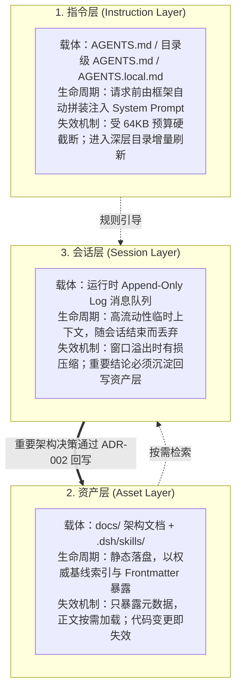

# 第 2 章：三层上下文架构剖析


DSH 框架通过将 Agent 的知识输入严格划分为三层，解决了大型软件项目中“上下文膨胀、幻觉蔓延、规则冲突与知识腐化”四大经典难题：



### 2.1 指令层：生命周期、预算截断与增量刷新
- **生命周期**：在会话的每个请求组装阶段，框架自项目根节点（`.git`）沿当前操作目录链向下递归收集所有 `AGENTS.md`，并以 `AGENTS.local.md` 作为本地覆盖。
- **源码机制分析**：
  在 `packages/context/agent-instructions/src/files.ts` 中，DSH 设定了严格的常量：
  ```typescript
  export const INSTRUCTION_BYTE_BUDGET = 65536; // 64 KB 预算红线
  ```
  当所有指令文件体积之和超出 65536 字节时，框架优先裁剪最宽泛的根规则，最后物理截断当前文件尾部并附带预警提示，从机制上防止系统 Prompt 吞噬业务推理空间。
- **动态延迟刷新**：
  依据 `packages/context/agent-instructions/src/state.ts`，子目录下的 `order/AGENTS.md` 并不会在启动时盲目全量加载，而是当 Agent 首次发出 `read_file` 访问该目录时，通过监听器将该目录推入 `visitedDirs`，从而在下一次轮次中按需装配，完美避免了无关子域规则对上下文的冗余污染。

### 2.2 资产层：基线剪枝与技能元数据隔离
- **权威基线索引的剪枝效应**：Agent 天生具有“探索全仓”的倾向。在 `AGENTS.md` 中设立 `## 权威基线`（明确索引 `docs/adr/`, `docs/tlcd/` 等核心路径），使得 Agent 在被询问设计约束时，工具调用从遍历全局的盲搜（`glob` + `grep`）精准收敛为单点直读（`read_file`），工具调用次数减少 75% 以上。
- **技能（Skill）的元数据与正文沙箱隔离**：
  在 `packages/skill/skill-filesystem/src/index.ts` 中，DSH 仅解析每个技能的 YAML Frontmatter（`name` 与 `description`）注入主会话目录。技能正文中的核心工作流与凭据（如 `AUDIT-TOKEN-731`）被严格隔离在磁盘中，直到 Agent 显式调用 `skill({ name: "context-audit" })` 时，正文才在单次工具执行上下文中装载。

### 2.3 会话层：流式本质与沉淀回写闭环
- **流式会话与压缩有损性**：会话层属于典型的“易失性工作内存（Working Memory）”。面对高并发与长上下文，框架的 Compaction 机制为了保全最新轮次的推理窗口，必然会对早期历史实施有损摘要，导致早期的具体凭据和细节完全丢失。
- **回写沉淀闭环（ADR-002）**：对抗会话遗忘的唯一架构手段，是将经过验证的会话结论以结构化文档形式回写到磁盘资产层（如 `docs/adr/ADR-002.md`），并同步更新指令层的权威基线索引，完成从“瞬时思考”到“持久化企业资产”的跨层飞跃。

---

